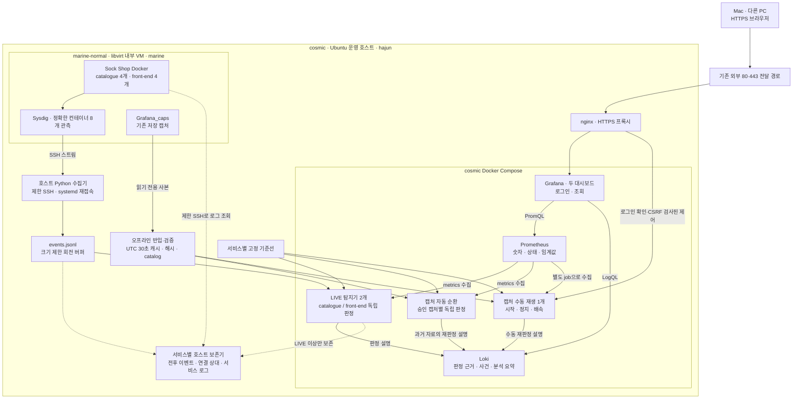

# HyCAD Monitor

**Sock Shop의 시스템콜을 Sysdig로 관측하고 HyCAD의 A/B/C 판정과 근거를 Grafana에서 보여주는 Ubuntu 운영 시스템이다.** `catalogue` 4개와 `front-end` 4개를 독립적으로 비교한다. 현재 입력을 보는 **LIVE**, 저장 자료를 재판정하는 **캡처 재생**을 구분하며 수집·판정·저장·웹 제공은 cosmic 서버에서 실행한다.

[아키텍처](docs/architecture.md) · [Ubuntu 실행](Grafana/README.md) · [서버 운영](docs/server-operations.md) · [검증 기록](docs/validation-2026-10-23.md) · [발표 순서](docs/presentation-runbook.md) · [UI·캡처 구현](docs/ui-and-replay-feasibility.md) · [원본 연구 설명](docs/research-overview.md)

> 2026-10-23 Ubuntu 서버 배포 후 실제 8개 컨테이너 입력, 승인 캡처 15개 로딩, 두 대시보드의 HTTPS 조회·인증 검사와 수동 재생 제어를 확인했다. Ubuntu 시험은 170개와 하위 시험 25개를 통과했다. 실제 호스트 재부팅·물리적 네트워크 단절 시험은 수행하지 않았으며, 항목별 확인 범위는 [검증 기록](docs/validation-2026-10-23.md)에 구분한다. 원본 논문의 성능 표와 자동 재학습 시뮬레이션은 [별도 문서](docs/research-overview.md)에 보존하며 현재 서비스의 탐지율·오탐률로 사용하지 않는다.

## 1. 전체 아키텍처

Prometheus가 탐지기의 `/metrics`를 가져오는 **pull 방식**이다. Grafana는 서버 내부 Prometheus·Loki에 질의한다. 브라우저가 Sysdig 원문 전체나 내부 데이터베이스에 직접 접근하는 구조는 아니다.

| 위치 | 실행 역할 | 보관 자료 |
|---|---|---|
| **cosmic 운영 호스트** (`hajun`) | Python 수집·보존기, HyCAD LIVE 2개, 자동·수동 재생, Prometheus·Loki·Grafana, nginx, systemd | 최근 수집 버퍼, 고정 기준선, 승인 캡처 사본·집계, 지표·설명, 보호된 사건 자료 |
| **marine-normal 대상 VM** (`marine`) | Sock Shop, catalogue 4개·front-end 4개, Sysdig, 제한된 캡처·로그 조회 래퍼 | 서비스 데이터·로그, 기존 `Grafana_caps` 캡처 |
| **Mac / 다른 PC** | HTTPS 브라우저. Mac은 코드 개발·복구 백업도 담당 | 코드·백업. 서버의 LIVE 수집·판정에 필요한 실행 주체가 아님 |

marine-normal은 cosmic 안의 libvirt NAT VM이다. 과거의 “졸작/외부 서버”와 “정상/내부 서버”는 **운영 호스트와 관측 대상 VM의 역할 명칭**이며 물리 서버 두 대라는 뜻이 아니다. “정상 서버”라는 이름도 공격 부재를 보증하지 않는다. cosmic 자체는 사설 LAN에 있고 기존 외부 전달 경로로 HTTPS를 제공한다.

외부 접속 주소는 운영 설정 `HYCAD_PUBLIC_URL`로 관리한다. **외부 HTTPS → cosmic nginx → Grafana**가 조회 경로이며 Mac Docker·SSH 터널·Tailscale Funnel에 의존하지 않는다. [HTTPS 운영](docs/direct-https.md)

## 2. 두 모드와 두 대시보드

| 화면 | 선택과 동작 | 용도 |
|---|---|---|
| **LIVE / 캡처 자동 재생** · `/d/hycad-overview` | 서비스, LIVE/캡처 모드, 캡처 ID 선택. 승인 캡처는 서버에서 독립적으로 순환 | 현재 상태 확인, 여러 과거 캡처의 빠른 비교 |
| **캡처 수동 재생** · `/d/hycad-replay` | `/hycad/replay/` 제어 페이지에서 캡처 하나를 처음부터 시작·일시정지·재개·중단 | 발표자가 원하는 시점부터 설명하는 시연 |

메인 화면은 **판정 흐름, 현재 분류, 입력 준비, 원본 시각, A/B/C의 임계값 대비 배수, 실제 A/B 초과 레플리카, 짧은 근거**를 먼저 보여준다. 기존 사건·보존·사후 분석 상세는 접힌 LIVE 조사 행에 남긴다. 원본 [Grafana 디자인](Grafana/reference/upstream-realtime.json)의 배치·비교 그래프·B 로그축·레플리카별 색과 선 스타일을 현재 지표에 맞게 연결했다.

LIVE/캡처 선택은 서버의 LIVE 탐지기를 중지하지 않는다. 자동 화면의 캡처 선택은 **이미 순환 중인 결과를 조회**한다. 처음부터 재생하고 싶으면 별도 수동 화면을 사용한다. 수동 작업은 로그인 사용자들이 공유하는 **동시 1개 작업**이다. 기존 작업이 재생·일시정지 중이면 중단 후 다른 캡처를 시작한다.

수동 속도는 원본 30초 창당 **2·5·10·30초**이며 15·6·3·1배속에 해당한다. 원본 이벤트 하나하나를 당시 간격대로 재현하는 기능은 아니다. 일시정지·종료·오류를 현재 정상 판정처럼 유지하지 않는다.

## 3. Sysdig → HyCAD → Grafana 흐름

1. VM의 Sysdig가 정확히 지정한 `catalogue` 4개와 `front-end` 4개의 이벤트를 한 스트림으로 내보낸다. 조사용 주소·포트·PID도 함께 수집한다.
2. cosmic의 상시 수집기가 제한된 SSH 키로 스트림을 받아 회전 파일에 기록한다. 입력 중단 때 재접속하며 공백을 표시한다.
3. 두 LIVE 탐지기가 같은 파일에서 **자기 서비스의 4개 레플리카만** 읽어 UTC 기준 30초 창을 구성한다. 서로 다른 서비스를 동료 레플리카로 비교하지 않는다.
4. 첫 창·마지막 불완전 창·누락·0 accept·수집 오류·오래된 입력은 **판정 불가**다. 유효한 창에서 고정 기준선과 A/B/C를 계산한다.
5. Prometheus가 LIVE·자동 재생을 5초마다, 수동 재생을 별도 job에서 1초마다 수집한다. Loki에는 원본 시각과 이번 처리 시각, 점수·임계값·판정 근거를 기록한다.
6. Grafana는 서비스·모드·캡처·재생 경로를 분리해 조회한다. 화면 기본 갱신은 5초다. **5초 갱신이 5초 탐지 지연을 보장하지는 않는다.**

저장 캡처는 별도 경로로 처리한다. VM의 `Grafana_caps`에 있는 대상 **15개(catalogue 13개, front-end 2개)**를 운영 호스트로 반입하고 원본 SHA-256을 기록한다. `capture_import.py`가 필요한 필드를 검증해 UTC 30초 캐시와 품질 메타데이터를 만들며, 해시가 고정된 `catalog.json`에 등록한 항목만 재생한다. 배포 검증에서 원본 파일 65개의 SHA-256 일치와 승인 캡처 15개 모두의 로딩·첫째 및 둘째 창 처리를 확인했다.

## 4. 판정과 normality drift의 의미

| 채널 | 계산 | 질문 |
|---|---|---|
| **A** | 10개 집합 특성의 레플리카 간 비대칭 차이 | 어떤 레플리카가 동료와 다른가 |
| **B** | 고정 기준선 대비 시스템콜 구성비의 레플리카별 z-score | 평소 분포에서 얼마나 벗어났는가 |
| **C** | `abs(log2((전체 이벤트 / accept·accept4 이벤트) / 기준값))` | 연결 관련 이벤트로 정규화한 활동량이 얼마나 달라졌는가 |

A 초과가 있으면 **부분 이상 의심**이다. A 초과 없이 B 조건과 C 초과가 함께 성립하면 **전체 이상 의심**, B 조건이 성립하고 C가 안정적이면 **정상 변화 의심(normality drift)**이다. B 정족수는 25%이므로 4개 중 1개만 초과해도 조건이 성립한다. 전체 분류와 실제 개별 초과 목록을 따로 표시한다.

front-end의 현재 컨테이너에서는 **Node 10.24.1**을 확인했다. 새 front-end 비교에는 `Grafana_caps/normal/capture_fe_norm`의 **Node 4 과거 정상 참조**를 고정해 사용한다. 버전 차이는 기준선 불일치와 drift를 조사할 이유지만, **Node 버전이 다르다는 사실만으로 drift 판정이나 정상 원인이 확인되는 것은 아니다.** 실제 창의 A/B/C 조건과 부하·이미지·연결 정책을 함께 확인한다.

2026-10-23 Ubuntu 저장 캡처 재판정에서 Node 10 비교 자료의 유효 59창은 모두 정상 변화 의심, Node 4 참조 자료의 유효 59창과 catalogue 참조의 유효 199창은 모두 정상으로 분류됐다. Node 10 첫 유효 창은 A=0(4개 모두), B≈7,606~7,863 > 6.05007, C≈0.11334 < 0.2였다. **저장 자료 결과이며 현재 LIVE drift나 Node 버전의 인과적 원인을 확정한 결과는 아니다.** 실제 LIVE 확인 창에서는 front-end의 C도 임계값을 넘어 전체 이상 의심으로 분류됐으며, 이를 공격 확인으로 해석하지 않는다. 참조 자료의 자기 기준선 평가를 독립 오탐률 측정으로 사용하지 않는다. [시각·점수를 포함한 검증 기록](docs/validation-2026-10-23.md#2-vm-수집과-live-판정-확인) · [발표용 근거와 한계](docs/presentation-runbook.md#6-front-end-normality-drift-설명)

현재 B는 z-score이며 온라인 자동 재학습을 수행하지 않는다. C의 분모는 HTTP 요청 수가 아닌 **accept 계열 이벤트 수**다. 모델의 이상 의심은 공격 확인이 아니며, drift도 실제 정상 변경이 입증됐다는 뜻이 아니다. 과거 캡처 이름이나 폴더 분류를 실제 공격의 정답 라벨로 자동 사용하지 않는다.

## 5. 근거와 조사 자료

LIVE의 최초 지목 창 **60초 전부터 창 종료 60초 후**까지 원본·연결 상대·관련 로그·이미지·재시작 정보를 별도 보존한다. catalogue와 front-end는 상태·보존 경로를 분리한다. 기본 보존 한도는 서비스별 7일·5GiB이며 누락·제한·수집 실패를 기록한다.

두 서비스의 로그 조회가 겹치면 공유 읽기 슬롯을 최대 5초 기다리고, 실제 조회는 최대 85초로 제한한다. SSH의 100초 제한 안에서도 대기·조회가 끝나지 않은 항목은 보존 성공으로 채우지 않고 누락 또는 제한으로 남긴다.

모델 근거와 지속 정보는 자동 생성한다. 공격을 뒷받침하는 관측, 정상 동작에 따른 오탐 가능성, 미확정 원인은 **보존 자료를 실제로 검토해 등록한 분석**으로 구분한다. 과거 결론을 새로운 사건에 자동 복사하지 않는다. 캡처 재생은 LIVE 경보와 실제 사건 자료 보존을 시작하지 않는다. [조사 자료 보존](docs/incident-preservation.md)

## 6. 툴과 수정할 파일

| 도구 | 역할 |
|---|---|
| Ubuntu · libvirt · Docker Compose | 운영 호스트, 대상 VM, 서비스·관측 컨테이너 실행 |
| Sysdig · OpenSSH · systemd | 시스템콜 관측, 제한된 전송, 부팅·재접속·복구 |
| Python · NumPy · prometheus-client | 집계·품질 검사, 고정 기준선 판정, 재생·근거·지표 제공 |
| Prometheus · Loki · Grafana | 수치 시계열, 설명 로그, 두 대시보드 |
| nginx · Certbot | 인증된 HTTPS 연결과 인증서 갱신 |
| Git · GitHub | 코드·구성·문서 이력과 발표용 코드 보관 |

| 변경 대상 | 관리 파일 |
|---|---|
| 화면 배치·표시·필터·쿼리 | [`scripts/build_dashboard.py`](scripts/build_dashboard.py) → [`monitoring/grafana/dashboards/`](monitoring/grafana/dashboards/) |
| 연결·수집 주기·경보 | [`monitoring/`](monitoring/), Compose YAML |
| 입력 검증·판정 근거·캡처 제어 | [`hycad_monitor/`](hycad_monitor/) |
| 연구 계산과 실제 임계값 | [`controller.py`](controller.py), [`channels.py`](channels.py) |

**YAML만 바꿔 모든 UI를 수정하는 구조는 아니다.** 패널 색상 기준 변경은 모델의 실제 임계값 변경과 다르다. 파일 변경 후 서버에 배포하고 결과를 확인해야 한다. GitHub push는 자동 배포가 아니다.

Windows 원본의 PowerShell·`.exe`·고정 `C:\...` 경로는 Ubuntu Bash·Python·Compose 진입점으로 바꿨다. 원본의 자동 재학습·익명 공개·전체 프로세스 종료·Prometheus 데이터 삭제 흐름은 이식하지 않는다. [이식 범위와 Ubuntu 실행](Grafana/README.md)

## 7. 발표와 운영

운영 구성은 `compose.yaml` + `compose.server.yaml` + `compose.public.yaml`, HTTPS는 별도 `compose.ingress.yaml`이다. Snap Docker 전용 소켓과 `deployment/systemd/snap/` 서비스를 사용한다. 이미 설치된 Ubuntu 서버에서는 `sudo bash Grafana/stack.sh config`, `build`, `start`, `status`로 구성을 확인하고 실행한다. 초기 설치·키·기준선·catalog 준비는 [서버 운영](docs/server-operations.md)을 따른다.

발표에서는 “VM에서 8개 컨테이너의 시스템콜을 모으고 서비스별 4개를 비교합니다. 현재 입력은 LIVE에서, 저장한 실험 자료는 자동·수동 재생에서 봅니다. Prometheus는 수치, Loki는 근거, Grafana는 판정과 실제 임계값 초과 대상을 보여줍니다. 정상 변화 의심과 공격 여부는 구분하고, 실제 원인은 보존 자료로 조사합니다” 순서로 설명할 수 있다.

공개 코드 업데이트 대상은 사용자 요청의 [DaeYejun2/HyCAD](https://github.com/DaeYejun2/HyCAD)다. 비공개 운영 사본과 Mac 복구 백업도 유지한다. **암호·SSH 키·실제 환경 파일·원본 캡처·민감 로그는 Git에 포함하지 않는다.** 코드 보관과 데이터·비밀 복구는 별개다.
