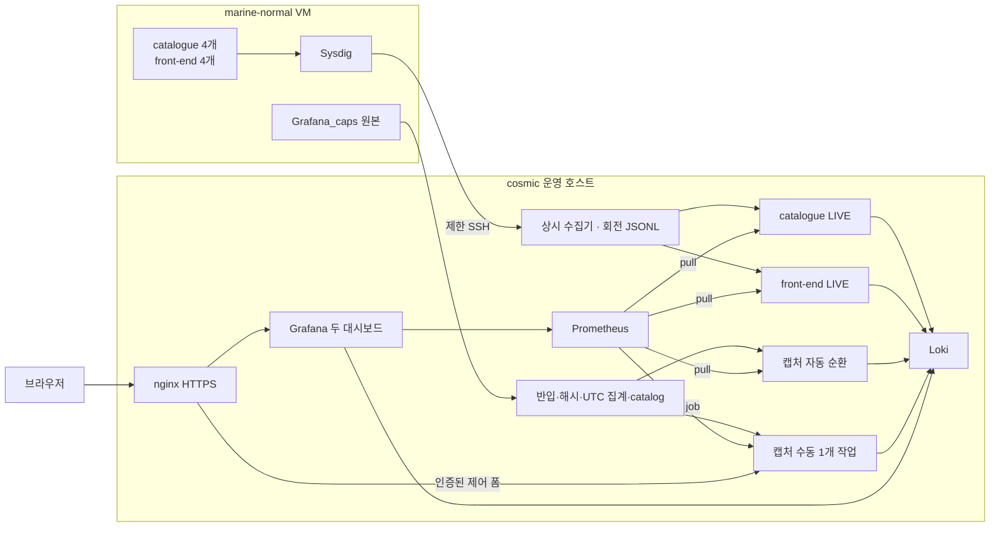

# HyCAD Ubuntu 관측 아키텍처

이 문서는 2026-10-23의 **catalogue·front-end LIVE, 캡처 자동 순환, 캡처 수동 재생** 구현을 설명한다. 배포 완료·외부 브라우저 시험·호스트 재부팅 여부는 별도의 검증 기록으로 확인한다. 발표용 배치 그림은 [README](../README.md), 운영 절차는 [서버 운영](server-operations.md)을 참고한다.

## 1. 서버와 실행 단위

cosmic은 Ubuntu 운영 호스트이며 marine-normal은 그 안의 libvirt NAT VM이다. VM에는 Sock Shop과 Sysdig, 호스트에는 수집·판정·저장·웹 제공 기능이 있다. “정상 VM”은 역할 이름이며 관측 결과나 공격 부재를 의미하지 않는다.

| 실행 단위 | 위치 | 입력·출력 |
|---|---|---|
| Sysdig 감독기 | VM root 소유 고정 래퍼 | 정확히 지정한 8개 컨테이너의 JSON 출력 |
| 수집기 | cosmic 호스트 Python·systemd | SSH 스트림 → `events.jsonl`과 회전본 |
| `detector` | cosmic Docker | catalogue 기준선·공유 이벤트 파일 → LIVE 지표·설명 |
| `detector-frontend` | cosmic Docker | front-end 기준선·공유 이벤트 파일 → 별도 LIVE 지표·설명 |
| `capture-replay` | cosmic Docker | 승인 catalog → 캡처별 반복 지표·설명 |
| `replay-control` | cosmic Docker | 승인 catalog·인증된 POST → 유한 수동 재생 하나 |
| 서비스별 보존기 | cosmic 호스트 Python·systemd | LIVE 사건 → 원본·연결·컨테이너 로그·보존 상태 |
| Prometheus·Loki·Grafana | cosmic Docker | 수치·설명 저장과 조회 화면 |
| nginx·Certbot | cosmic 별도 Compose·타이머 | 외부 HTTPS, 내부 프록시, 인증서 갱신 |

Mac은 브라우저·개발·백업 역할이다. Mac의 로컬 Docker나 터널을 상시 경로에 두지 않는다. 직접 공개 경로는 `HYCAD_PUBLIC_URL`로 관리하며 Grafana의 익명 접근은 비활성화한다. 내부 Prometheus·Loki·제어 서비스의 metrics 포트를 직접 공개하지 않는다.

## 2. LIVE 입력과 서비스 분리

VM의 `serve_capture.py`는 `docker-compose_catalogue_1`~`4`, `docker-compose_front-end_1`~`4`만 허용한다. 이름 접두어가 비슷한 DB나 새 컨테이너를 자동 포함하지 않는다. 수집 키는 이 고정 명령만 실행하며 원격 셸이나 임의 수집 인자를 받지 않는다.

두 탐지기는 같은 회전 파일을 읽지만 **자기 기준선의 고정 레플리카 집합**만 집계한다. 다른 서비스 이벤트는 해당 탐지기의 비교 집합에 들어가지 않는다. catalogue와 front-end의 기준선·모델 상태·사건 상태·보존 건강 상태가 분리되어 있다.

시스템콜 입력은 줄마다 JSON 하나이며 평평한 필드 또는 `output_fields`를 지원한다. 시각은 `evt.rawtime` 나노초, 식별자는 `k8s.pod.name` 또는 `container.name`, 이벤트 종류는 `evt.type`이다. `preprocess.FIELD_MAP`의 특성 필드도 필요하며 값이 없는 필드는 명시적 null을 사용한다.

LIVE는 시작 시 파일 끝에서 새 입력을 기다린다. 과거 파일을 LIVE 입력으로 지정해 역사 자료를 현재 자료로 표시하지 않는다. 파일 교체·축소·재접속·파싱 실패·오래된 시각을 품질 오류로 처리한다.

## 3. 창과 판정 계약

- 창은 **UTC 기준 30초**다. 다음 구간의 유효 이벤트가 이전 창 완료를 확인하는 기준이다.
- 시작 첫 창과 입력 복구 첫 창은 부분 관측일 수 있어 제외한다. 벽시계가 지났다는 이유만으로 수집 완료를 확정하지 않는다.
- 레플리카 누락, 빈 이벤트, accept 계열 분모 0, 특성 한도 초과, 수집 오류는 `insufficient_data`다.
- 레플리카 집합을 누락에 맞춰 자동 축소하지 않는다. 동일 서비스의 최소 2개와 고정된 대응을 요구한다.
- 입력 신선도와 exporter 생존은 다르다. health가 살아 있어도 유효한 창이 없으면 판정 불가다.
- 원본 창 시작·끝과 이번 처리 시각을 따로 저장한다.

연구 계산은 `channels.py`, `controller.py`에 있고 운영 입력·품질·수명 관리만 `hycad_monitor/`가 담당한다. 기존 A/B/C 계산과 임계값 결정 규칙을 UI 이식 과정에서 바꾸지 않는다.

| 채널 | 운영 계산과 해석 |
|---|---|
| A | 10개 집합 특성의 동료 간 비대칭 차이. 레플리카별 점수 |
| B | 고정 과거 기준선 대비 시스템콜 구성비의 레플리카별 z-score |
| C | 전체 이벤트/accept 계열 이벤트 비율의 정상 기준 대비 절대 log2 변화 |

A 초과는 부분 이상 의심이다. A가 침묵하고 B 정족수와 C 초과가 함께 성립하면 전체 이상 의심, B 정족수만 성립하고 C가 안정적이면 정상 변화 의심이다. B 정족수는 25%이며 전체 분류가 모든 레플리카의 B 초과를 뜻하지 않는다.

C는 HTTP 요청당 실제 비용이 아니다. 연결 재사용·부하·이벤트 방향·성공 여부 정책이 점수에 영향을 줄 수 있다. drift는 모델의 분류이며 정상 변경의 원인이 확정됐다는 뜻이 아니다. 시스템은 공격 차단이나 자동 원인 확정도 수행하지 않는다.

## 4. 기준선과 front-end 변화 관측

각 실행은 정상 참조 캐시를 고정한다. 알려지지 않은 시스템콜 차원이 등장하면 기존 정상 자료의 해당 빈도를 0으로 놓고 다시 보정한다. 새 LIVE·공격·재생 자료로 학습하거나 기준선을 자동 교체하는 동작이 아니다. B는 z-score를 명시하며 실험용 오토인코더를 환경변수로 몰래 선택하지 않는다.

front-end의 현재 4개 컨테이너에서 Node 10.24.1을 확인했고, 비교 기준은 `Grafana_caps/normal/capture_fe_norm`의 Node 4 과거 정상 참조다. 이 차이를 화면의 기준선 설명에 남긴다. 현재 Node 10 자료를 별도 검증 없이 새 정상으로 학습시키지 않는다.

Ubuntu 저장 캡처 재판정에서는 Node 10 자료의 유효 59창이 모두 drift, Node 4 참조의 유효 59창과 catalogue 참조의 유효 199창이 모두 normal이었다. Node 10 첫 유효 창은 A=0(4개), B≈7,606~7,863 > 6.05007, C≈0.11334 < 0.2로 drift 분기를 만족했다. 이는 저장 자료의 관측이며 현재 LIVE의 분류나 버전 변경의 인과 증명은 아니다. 참조 자료의 자기 평가를 독립 FPR로 해석하지 않는다.

버전 차이만으로 drift라고 판정하지 않는다. 실제 유효 창의 A/B/C 결과, 서비스 로그·이미지, 부하·연결 정책을 확인해야 한다. 기존 정상 참조가 현재 환경에 맞지 않아 오탐이 발생할 가능성도 분리해서 보고한다. 현재 환경의 탐지율·오탐률 검증은 별도 실험이다.

## 5. 저장 캡처 경로

이번 대상은 VM `Grafana_caps`의 15개 JSONL gzip이다. cosmic의 보호된 사본을 오프라인으로 검증·집계한 뒤 catalog에 등록한다. 캡처 제목·시나리오 이름은 출처 표기이며 공격의 정답 라벨로 자동 사용하지 않는다.

`capture_import.py`가 UTC 창, 첫/끝 불완전, 오류·누락·공백, 원래 레플리카 집합을 보존한다. 캐시는 실행 객체를 허용하지 않는 primitive pickle 로더로 읽으며 크기·특성·품질·시각·해시를 확인한다. 원본 JSONL/gzip은 지원하고 CSV·바이너리 scap은 직접 지원하지 않는다.

catalog는 ID·서비스·제목·캐시/기준선 상대 경로와 해시·참조 설명을 담는다. 디렉터리 밖 경로와 symlink, 중복 ID, 허용 한도 초과를 거부한다. 원본 파일 경로나 명령행을 브라우저가 지정하지 않는다.

자동 재생은 캡처마다 독립 Detector·사건 추적기를 만들고 기본 5초마다 원본 30초 창을 재판정한다. 순환 경계에서 상태를 초기화한다. 수동 재생은 한 캡처를 처음부터 한 번 실행하며 2·5·10·30초 간격과 시작·일시정지·재개·중단을 제공한다. 두 경로는 LIVE에 영향을 주지 않는다.

기존 연구 전처리는 첫 이벤트 기준 창을 사용했으므로 새 UTC 집계와 결과가 달라질 수 있다. 정확 재현에는 동일한 코드·기준선·창 경계·레플리카 매핑·필드·수집 공백 정보가 필요하다. 과거 자료의 재판정은 현재 공격 실행이 아니다.

## 6. 저장·조회·인증

| 경로 | 지표 구분 | 수집 |
|---|---|---|
| catalogue/front-end LIVE | `job=hycad`, `mode=live`, `capture=live`, 서비스 라벨 | 5초 |
| 캡처 자동 순환 | `job=hycad`, `mode=replay`, 승인 capture ID | 5초 |
| 캡처 수동 재생 | `job=hycad-manual`, `mode=replay`, 승인 capture ID | 1초 |

Loki는 `deployment`, `mode`, `capture`, `playback`으로 구분하며 수동 결과는 `playback=manual`이다. 긴 설명·원본 경로·명령행은 시계열 라벨에 넣지 않는다. 설명에 공개하는 예시는 제한된 프로세스 이름·시스템콜 등이며 민감한 인자·경로 원문은 보호한다.

수동 제어는 동일 HTTPS의 `/hycad/replay/`에서 Grafana 세션 쿠키를 내부 `/api/user`로 확인한다. 로그인 사용자들이 공유하는 시연 작업 하나를 제어한다. Origin·CSRF·POST·본문 크기·허용 ID·속도를 검사하며 익명 사용이나 임의 셸 실행을 허용하지 않는다. 세션·CSRF 값을 로그로 남기지 않는다.

## 7. 증거 보존과 자동 복구

LIVE 이상에만 전후 60초·연결 상대·컨테이너 로그 보존을 연결한다. catalogue와 front-end는 각각 상태·보존 디렉터리를 사용한다. 최대 서비스별 7일·5GiB의 제한된 자료이며 원본 범위 부족·로그 제한·전송 실패는 기록한다. 정상 복귀와 관측 공백을 구분한다.

사후 분석은 보존 자료를 검토해 별도 등록한다. 공격 근거·오탐 가능성·미확정 원인을 구분하며 과거 사건 결론을 새 사건에 자동 적용하지 않는다. 자세한 항목은 [조사 자료 보존](incident-preservation.md)을 따른다.

systemd가 호스트 수집·보존·Compose 기동을 감독하고 Docker 재시작 정책이 컨테이너를 복구한다. 실제 Snap Docker 소켓은 `/var/snap/docker/common/hycad/docker.sock`이다. 코드 릴리스와 `live`, `captures`, 사건 자료·시계열 볼륨을 분리한다. 재시작 검증과 실제 호스트 재부팅 검증은 따로 남긴다.

Windows 원본의 UI는 채택하되 PowerShell·고정 드라이브 경로·`.exe`는 Ubuntu용 진입점으로 대체했다. 원본의 재학습·익명 공개·TSDB 삭제·포괄적인 프로세스 종료 흐름은 운영 경로에 넣지 않는다. 세부 파일과 수정법은 [UI·재생 구현](ui-and-replay-feasibility.md)을 참고한다.
