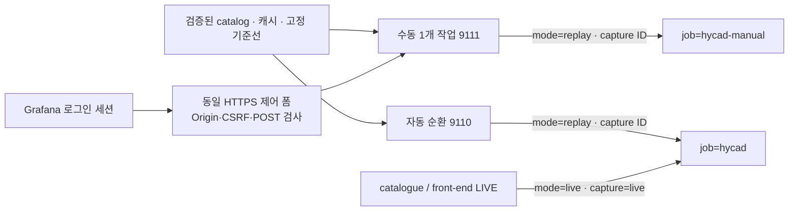

# UI와 캡처 재생 구현

2026-10-23 확장 구현을 설명한다. 이전의 가능성 검토 단계에서 **LIVE/캡처 모드, 자동 순환, 인증된 수동 재생** 코드로 확장했다. 코드의 지원 범위와 실제 원격 배포 시험 결과는 구분한다. 서버별 구성은 [README](../README.md), Ubuntu 진입점은 [Grafana 안내](../Grafana/README.md)를 참고한다.

## 1. 두 화면의 역할

| 화면 | 데이터 | 사용자 동작 |
|---|---|---|
| `/d/hycad-overview` | LIVE 두 서비스 또는 자동 순환 중인 저장 캡처 | 서비스·모드·캡처 ID 선택 |
| `/d/hycad-replay` | 수동으로 시작한 저장 캡처 하나 | 현재 작업의 판정·근거·진행 상태 조회 |
| `/hycad/replay/` | 위 수동 작업의 제어 폼 | 캡처 선택, 처음부터 시작·일시정지·재개·중단·배속 선택 |

메인 화면의 LIVE/캡처 전환은 **조회 대상 변경**이다. LIVE 수집과 두 서비스의 판정은 계속된다. 자동 순환은 각 캡처가 이미 독립 실행 중이므로 선택 순간 처음으로 돌아가지 않는다. 정확히 처음부터 설명할 때 수동 재생 화면을 사용한다.

수동 재생은 사용자마다 별도로 생기는 세션이 아니라 **로그인 사용자들이 공유하는 한 작업**이다. 재생·일시정지 중인 작업을 새 선택으로 덮어쓰지 않으며, 먼저 중단해야 한다. 속도 변경은 일시정지 후 원하는 속도로 재개한다. 완료 후 새로 시작하면 첫 창부터 다시 계산한다.

| 수동 간격 | 원본 집계 창 | 표시 속도 |
|---|---|---|
| 2초 | 30초 | 15배속 |
| 5초 | 30초 | 6배속 |
| 10초 | 30초 | 3배속 |
| 30초 | 30초 | 1배속 |

원본 시스템콜의 개별 발생 간격을 재현하는 도구는 아니다. 일시정지·중단·완료는 별도 상태이며 최신 유효 정상 판정으로 유지하지 않는다. 화면 기본 5초 새로고침에서는 빠른 재생의 중간 창을 놓칠 수 있으므로 원본 창 시각·그래프·Loki 기록을 함께 확인한다.

## 2. UI 이식 범위

[원본 디자인 사본](../Grafana/reference/upstream-realtime.json)의 판정 흐름, 비교·빈도·작업량 그래프, 점수/임계값 배수, B 로그축, 레플리카별 색·선 구분을 사용한다. 원본 JSON의 데이터소스 UID·라벨·지표를 그대로 덮어씌우면 현재 exporter와 맞지 않으므로 현재 계약에 맞게 생성한다.

핵심 판단은 현재 분류, 입력 준비, 원본 시각, A/B/C, 실제 A/B 초과 대상, 짧은 설명이다. 기존 보존·사건 지속·검토 결과는 메인 화면의 **접힌 LIVE 조사 행**에 유지한다. 수동 재생에 LIVE 조사 자료를 섞지 않는다.

| 수정 내용 | 원본 파일 | 적용 방식 |
|---|---|---|
| 배치·색·표·쿼리·변수·링크 | [`scripts/build_dashboard.py`](../scripts/build_dashboard.py) | 생성 후 두 JSON을 검토·배포 |
| 생성된 대시보드 | [`dashboards/`](../monitoring/grafana/dashboards/) | Grafana 파일 프로비저닝 |
| 접힌 조사 패널 템플릿 | [`live-investigation-panels.json`](../monitoring/grafana/templates/live-investigation-panels.json) | 생성기에 반영 |
| 데이터소스·대시보드 등록 | [`provisioning/`](../monitoring/grafana/provisioning/)의 YAML | Grafana 시작·재적용 |
| 수집 대상·주기 | [`prometheus.live.yml`](../monitoring/prometheus/prometheus.live.yml) | 검사 후 Prometheus reload/재시작 |
| 경보 조건 | [`rules.yml`](../monitoring/prometheus/rules.yml) | LIVE 조건과 준비 상태 유지 |
| 새 점수·설명·메타데이터 | [`hycad_monitor/`](../hycad_monitor/) | 이미지 재빌드·해당 서비스 재생성 |
| 실제 모델 계산 | `channels.py`, `controller.py` | 별도 모델 변경과 검증 필요 |

Grafana JSON을 직접 바꿨다면 다음 생성에서 덮어써질 수 있다. 지속할 변경은 생성기나 템플릿에 반영한다. 화면의 색상 기준을 바꿔도 모델의 실제 판정 임계값은 바뀌지 않는다.

현재 파일 대시보드는 `allowUiUpdates: false`다. 조회 계정이 브라우저에서 편집한 내용을 Git에 저장하는 방식이 아니다. GitHub push만으로 서버 화면도 자동 배포되지 않는다. 파일 프로비저닝, 릴리스 마운트, 실제 화면 반영을 확인한다. [Grafana provisioning](https://grafana.com/docs/grafana/latest/administration/provisioning/)

## 3. 캡처 입력과 원본 시각

이번 등록 대상은 marine-normal의 `Grafana_caps`에 있던 **15개 JSONL gzip 파일(catalogue 13개, front-end 2개)**다. 폴더·파일명은 출처 설명이며 실제 공격 여부나 정상 여부를 자동 증명하지 않는다. 원문은 cosmic의 보호된 캡처 디렉터리에 복사하고 Git에는 넣지 않는다.

`capture_import.py`는 평평한 Sysdig JSON 또는 `output_fields` 객체 안의 JSON을 읽는다. 필수 특성 필드가 누락되었을 때 임의의 빈 값으로 채우지 않는다. CSV·바이너리 `.scap`은 직접 지원하지 않으며 원본 필드를 보존한 JSONL로 먼저 내보내야 한다.

```bash
python -m hycad_monitor.capture_import   --input SOURCE.jsonl.gz --output CAPTURE.pkl   --replicas REPLICA_1,REPLICA_2,REPLICA_3,REPLICA_4
```

출력은 primitive pickle 집계 캐시와 `CAPTURE.metadata.json`이다. 이미 존재하면 기본적으로 거부하며 재변환을 의도할 때만 `--overwrite`를 사용한다. 관리자용 오프라인 변환 명령이며 웹에서 경로나 셸 명령을 받지 않는다.

- UTC 기준 30초 경계를 사용하고 원본 시각을 유지한다.
- 첫 창과 EOF 마지막 창은 전체 관측 여부를 확인할 수 없어 불완전으로 남긴다.
- 빈 창·누락 레플리카·0 accept를 정상으로 대체하지 않는다. 파일 전체에서 레플리카가 빠져도 비교 대상을 자동 축소하지 않는다.
- 파싱 오류·필수 필드 오류·수집 재시작·이미 닫힌 창의 지연 이벤트는 해당 품질 상태를 보존한다.
- 같은 30초 안의 순서 변경은 집계 값을 바꾸지 않으므로 진단 건수로 남긴다. 큰 공백의 생략 창 수에도 한도를 둔다.
- 원본·캐시 SHA-256, 바이트 수, 원본 관측 범위, 레플리카 목록, 창 수와 품질 사유를 기록한다.

이 품질 메타데이터는 캐시를 다시 열어도 유지되고 기준선 보정에도 반영된다. 기존 연구 캐시의 캡처 첫 이벤트 기준 창은 그대로 보존한다. 따라서 새 UTC 변환 결과와 과거 연구 계산이 언제나 같다고 주장하지 않는다. 같은 결과를 재현하려면 코드·기준선·창 경계·특성 정책·레플리카 대응·수집 공백을 맞춰야 한다.

## 4. 승인 catalog와 실행 격리

`catalog.json`의 `schema_version`은 1이다. 각 항목에는 `id`, `deployment`, `title`, `cache`, `cache_sha256`, `baseline`, `baseline_sha256`, `reference_description`을 지정한다. 선택 항목은 `replicas`, `source_name`, `source_sha256`이다. 경로는 **catalog 디렉터리 안의 상대 경로**이며 외부 경로·경로 탈출 symlink·중복 ID·잘못된 해시는 거부한다.

catalog 변경은 관리자 배포 작업이다. 컨트롤러는 임의 업로드나 웹 경로를 실행하지 않는다. 기본 상한은 64개 캡처, 캐시 파일당 64MiB, 기준선을 포함한 총 직렬화 크기 128MiB, 총 원본/기준선 창 20,000개다. Docker CPU·메모리 제한도 별도로 적용한다.



각 자동 캡처는 별도 Detector·기준선·사건 상태를 갖는다. 반복 경계에서 모델의 확장 어휘와 사건 상태를 초기화하며 기준선은 다시 해시 검증한다. 기존 정상 자료 외의 재생 데이터를 학습하지 않는다. 수동 재생은 같은 계산을 사용하되 한 번 완료되면 자동으로 다시 시작하지 않는다.

## 5. 인증·지표·로그 계약

수동 제어는 브라우저의 Grafana 세션 쿠키를 내부 Grafana `/api/user`에서 확인한다. 비로그인 요청은 거부하며 사용자 식별 헤더를 신뢰하지 않는다. 상태 변경은 동일 Origin의 제한된 POST 폼, 만료되는 사용자별 CSRF 토큰, 승인된 캡처 ID·속도만 허용한다. 현재 설계는 로그인한 조회 사용자도 공유 시연 작업을 제어할 수 있다.

nginx는 `/hycad/replay/`만 수동 서비스에 전달한다. `/metrics`는 서버 내부 수집 경로다. 제어 서비스는 셸을 실행하지 않으며 LIVE 수집·기준선·알림 설정을 수정하지 않는다.

공통 지표 라벨은 `deployment`, `mode`, `capture`다. 자동/LIVE와 수동은 Prometheus job도 다르다. Loki는 수동 결과를 `playback="manual"`로 구분한다. 따라서 같은 캡처를 두 화면에서 보더라도 실행 결과가 섞이지 않는다.

추가 지표는 `hycad_capture_info`, 원본 시작/끝, 현재 창 번호/총 창 수, 순환 횟수, 재생 간격, 진행률이다. `hycad_manual_state`는 대기·재생·일시정지·완료·중단·오류를 표시한다. 시간축은 **이번 처리 시각**, 별도 원본 창 표시는 **과거 캡처 시각**이다.

캡처는 LIVE 경보를 발화시키거나 현재 서비스의 조사 자료를 보존하지 않는다. front-end의 Node 4 과거 참조와 현재 Node 10 차이는 조사할 기준선 조건이며, 화면에서 정상 변화 의심이 나왔다는 사실만으로 정상 원인이 확정되지는 않는다.

## 6. 반영과 확인

생성기를 실행하고 JSON·PromQL/LogQL·테스트를 확인한 뒤 Ubuntu 이미지를 빌드한다. 수집 래퍼, 두 LIVE 서비스, catalog, 자동·수동 worker, 두 대시보드, nginx 경로를 함께 배포한다. 각 컨테이너의 health와 **실제 원본 창 진행**을 별도로 확인한다.

최종 확인 대상은 서비스별 4개 입력, 자동 캡처 선택, 수동 처음부터 시작·일시정지·재개·중단, 원본 시각·기준선 표시, 익명/CSRF 차단, LIVE가 계속 진행하는지 여부다. 실제로 수행한 원격 확인만 배포 검증 기록에 남긴다. 자세한 순서는 [발표 실행 가이드](presentation-runbook.md)를 따른다.
